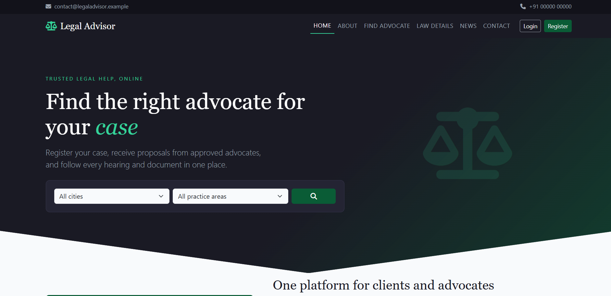
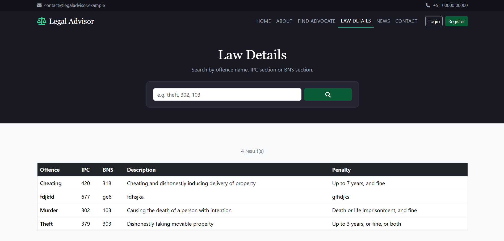
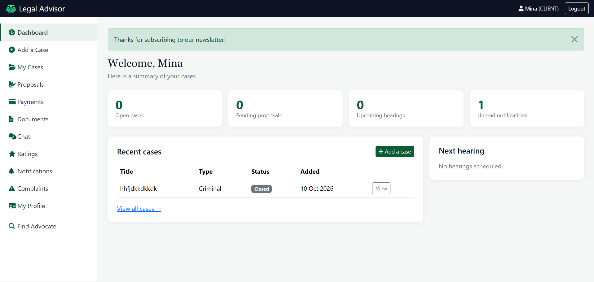
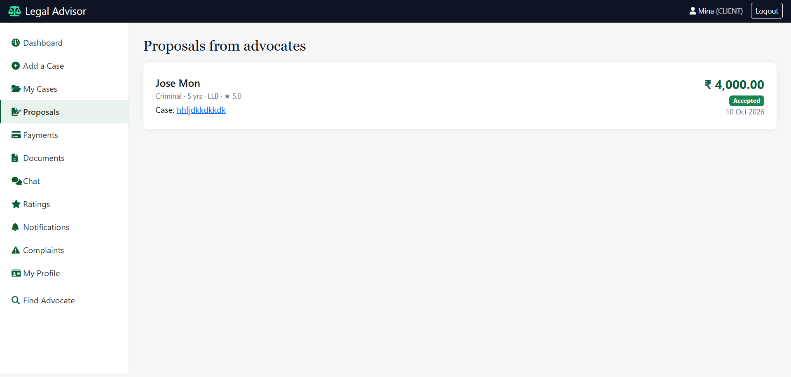
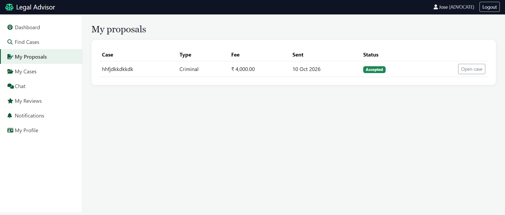
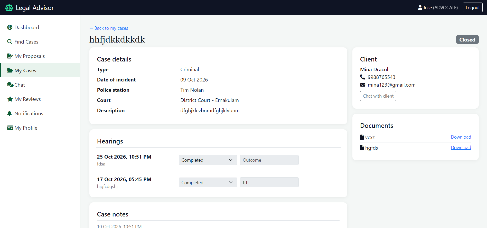
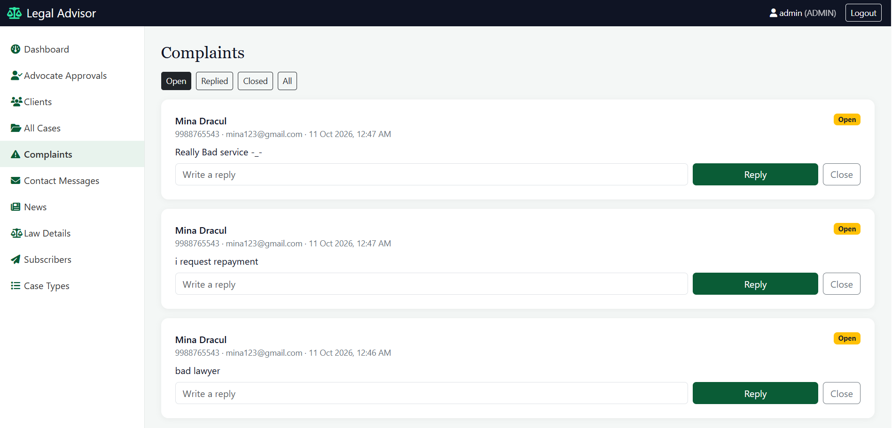
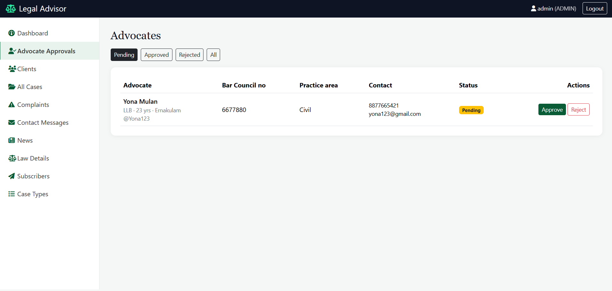
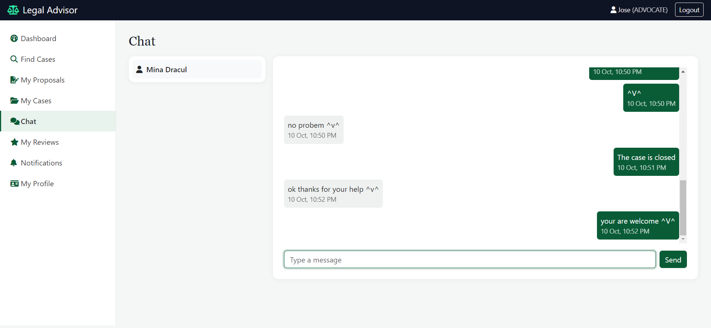

# Legal Advisor (LawSystem)

A web platform that connects clients with approved advocates and helps manage a legal case from filing to closing: fee proposals, payment, hearings, documents, chat and ratings.

Built as an academic project with **PHP, MySQL, PDO and Bootstrap 5**.

## Screenshots

### Public
| Home | Law Details search |
|---|---|
|  |  |

### Client
| Dashboard | Fee proposals |
|---|---|
|  |  |

### Advocate
| Browse open cases | Case management |
|---|---|
|  |  |

### Admin
| Dashboard | Advocate approval |
|---|---|
|  |  |

### Chat


## Features

### Public
- Home page with advocate search by city and practice area
- Law Details search by offence name, IPC section or BNS section
- Legal news, About and Contact pages
- Newsletter sign-up
- Client registration and advocate registration

### Client
- File a case and track its status (pending, proposed, assigned, ongoing, closed)
- Receive fee proposals from advocates; accept one
- Make a payment (simulated) to start the case
- View hearings, case notes and documents; upload and download documents
- Chat with the assigned advocate
- Rate and review the advocate after the case is closed
- Notifications, complaints to the admin, profile and password change

### Advocate
- Registers and waits for **admin approval** before logging in
- Browse open cases and send a fee proposal; withdraw pending proposals
- Manage assigned cases: schedule hearings, record outcomes, add notes, upload documents, close the case
- Hearings and notes unlock only after the client has paid
- A case cannot be closed while a hearing is still scheduled
- Chat with clients, view reviews, notifications, profile

### Admin
- Approve or reject advocate registrations; enable or disable accounts
- Manage clients and view all cases
- Reply to client complaints
- Read contact-form messages
- Manage news, law details (IPC/BNS), case types and newsletter subscribers

## Tech stack

| Layer | Technology |
|---|---|
| Backend | PHP 8.x (PDO, prepared statements) |
| Database | MySQL / MariaDB |
| Frontend | HTML, CSS, Bootstrap 5, Font Awesome |
| Server | Apache (WAMP / XAMPP) |

## Security measures
- Passwords hashed with `password_hash()` (bcrypt)
- PDO prepared statements on all queries
- Output escaped with `htmlspecialchars` to prevent XSS
- CSRF token on every POST form
- Role-based access control; sessions re-checked against the database on each request
- Ownership checks so users can only open their own cases and files
- Session ID regenerated on login

## Installation (local)

1. Install [WAMP](https://www.wampserver.com/) or XAMPP and start Apache and MySQL.
2. Copy this folder to `C:\wamp64\www\LawSystem` (or your server's web root).
3. Open phpMyAdmin, create a database named `legal_advisor`, and **import** `database/legal_advisor.sql`.
4. Copy `config/database.example.php` to `config/database.php` and enter your database name, username and password.
5. If your folder is not named `LawSystem`, change `BASE_URL` in `config/autoload.php`.
6. Make sure the `uploads/` folder is writable.
7. Set the admin password. The SQL file contains a placeholder hash, so generate a real one:

   ```
   php -r "echo password_hash('YourStrongPassword1', PASSWORD_DEFAULT);"
   ```

   Then run in phpMyAdmin:

   ```sql
   UPDATE login SET password_hash = '<paste hash here>' WHERE username = 'admin';
   ```

8. Open `http://localhost/LawSystem/` and log in at `/login.php`.

## Demo accounts

Create these after installing (use your own passwords):

| Role | Username | Notes |
|---|---|---|
| Admin | `admin` | created in step 7 |
| Client | register at `/register_client.php` | |
| Advocate | register at `/register_advocate.php` | approve it from the admin panel |

> Tip: log in to each role in a different browser (or Incognito window). They share one session per browser.

## Project structure

```
LawSystem/
├── admin/          admin pages (approvals, clients, cases, complaints, news, laws ...)
├── advocate/       advocate pages (browse cases, proposals, case management, chat ...)
├── client/         client pages (add case, proposals, payments, documents, chat ...)
├── assets/         css, js
├── classes/        DataAccess (PDO helper), FormValidator, FileUpload
├── config/         autoload.php, database.php (not committed)
├── includes/       headers, footers, sidebars, form helpers
├── uploads/        uploaded case documents (not committed)
├── database/       SQL schema
└── *.php           public pages (index, login, register, news, contact ...)
```

## Case workflow

`pending` → advocate sends proposal → `proposed` → client accepts → `assigned` → client pays → `ongoing` → advocate closes → `closed` → client rates the advocate.

## Known limitations / future work
- Payments are simulated; no real gateway or receipts
- No self-service password reset yet
- Chat reloads the page (no real-time updates)
- No pagination on long admin lists
- Newsletter emails are collected, not sent automatically
- Court management page not built

## Author

Mary Sandra K.X · [LinkedIn](https://www.linkedin.com/in/marysandra) · [GitHub](https://github.com/msan432003-star)

*Academic project, not legal advice.*
